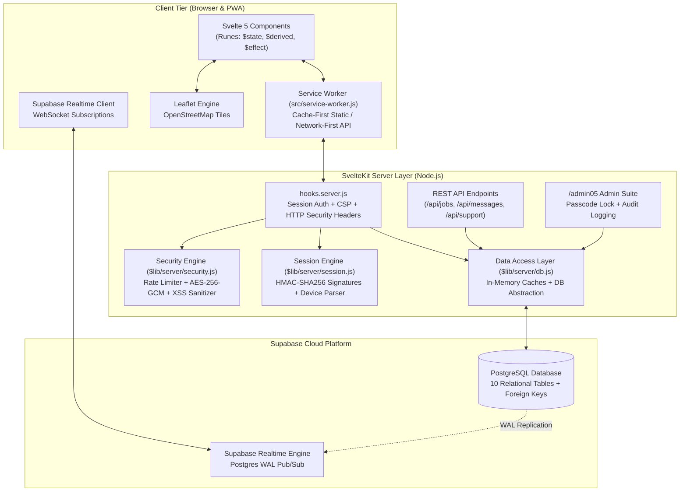
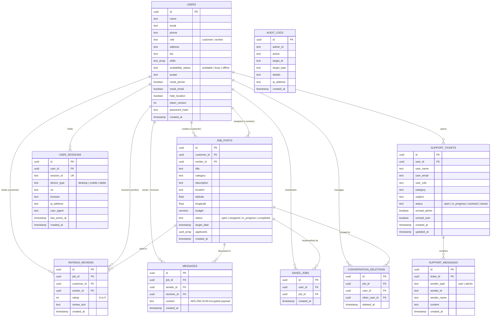

# 🛠️ Serviee — Hyperlocal On-Demand Service & Handyman Marketplace

<p align="center">
  
</p>

<p align="center">
  <strong>Connect local sideline workers, handymen, and skilled tradespeople with clients in their community.</strong>
</p>

<p align="center">
  
  
  
  
  
  
  
</p>

---

## 📖 Table of Contents

- [🌟 Overview](#-overview)
- [✨ Key System Features](#-key-system-features)
  - [1. Customer (Service Seeker) Journey](#1-customer-service-seeker-journey)
  - [2. Worker (Service Provider) Journey](#2-worker-service-provider-journey)
  - [3. End-to-End Real-Time Messaging & Media](#3-end-to-end-real-time-messaging--media)
  - [4. Built-in Customer Support & Live Ticketing](#4-built-in-customer-support--live-ticketing)
  - [5. Interactive Map & Geolocation Engine](#5-interactive-map--geolocation-engine)
  - [6. Admin Back-Office & Moderation Suite (`/admin05`)](#6-admin-back-office--moderation-suite-admin05)
  - [7. Privacy, Security & Session Management](#7-privacy-security--session-management)
- [🏗️ System Architecture & Data Flow](#-system-architecture--data-flow)
- [🛡️ Security & Authentication Deep Dive](#-security--authentication-deep-dive)
  - [HMAC Session Signing & Invalidation](#hmac-session-signing--invalidation)
  - [Multi-Device Active Session Tracking](#multi-device-active-session-tracking)
  - [Chat Encryption at Rest (AES-256-GCM)](#chat-encryption-at-rest-aes-256-gcm)
  - [Sliding-Window Rate Limiter](#sliding-window-rate-limiter)
  - [Content Security Policy & HTTP Hardening](#content-security-policy--http-hardening)
- [🗄️ Database Architecture & Entity Relationships](#-database-architecture--entity-relationships)
  - [Entity Relationship Diagram](#entity-relationship-diagram)
  - [Table Directory](#table-directory)
- [📁 Project Directory & Component Structure](#-project-directory--component-structure)
- [🔌 REST & Realtime API Reference](#-rest--realtime-api-reference)
- [⚙️ Environment Variables](#-environment-variables)
- [🚀 Getting Started & Installation](#-getting-started--installation)
  - [Prerequisites](#prerequisites)
  - [Installation Steps](#installation-steps)
  - [Database Setup & Migrations](#database-setup--migrations)
  - [Running Locally](#running-locally)
- [📱 Progressive Web App (PWA) Capabilities](#-progressive-web-app-pwa-capabilities)
- [🛠️ NPM Development Scripts](#-npm-development-scripts)
- [📄 License](#-license)

---

## 🌟 Overview

**Serviee** is a full-featured, mobile-first hyperlocal freelance and handyman marketplace web application. Designed specifically for community-centric labor exchange, Serviee connects residents and business owners needing physical services (e.g., plumbing, electrical maintenance, carpentry, hauling, painting, and yard work) with qualified local freelancers and tradespeople within their immediate geographic radius.

Engineered with modern web standards, Serviee combines:
* **Svelte 5** leveraging fine-grained reactivity via **Runes** (`$state`, `$derived`, `$props`, `$effect`, `$bindable`).
* **SvelteKit 2** providing hybrid SSR, server load functions, form actions, and API endpoints.
* **Tailwind CSS v4** powering responsive layouts, dynamic theme variables, glassmorphic surfaces, and seamless dark/light modes.
* **Supabase (PostgreSQL & Realtime)** handling persistence, relational constraints, and zero-latency WebSocket subscriptions.
* **Leaflet & OpenStreetMap** powering coordinate pickers, distance radiuses, and interactive visual map feeds without Google Maps API cost overheads.
* **Zero-Trust Security & Cryptography** featuring HMAC-SHA256 session signatures, token version revocation, multi-device management, sliding-window rate limiting, and authenticated AES-256-GCM message encryption.

---

## ✨ Key System Features

### 1. Customer (Service Seeker) Journey
* **Job Posting Wizard (`/customer/post-job` & modal)**:
  * Nine industry categories: *Plumbing, Electrical, Carpentry, Painting, Cleaning, Gardening, Appliance Repair, Moving & Hauling, General Labor*.
  * Location selection using Philippine municipality/city autocomplete with pre-computed centroids (`CityAutocomplete.svelte`) and interactive Leaflet map pin drop (`LocationPickerModal.svelte`).
  * Flexible budget estimation and target completion scheduling with automated date constraints.
* **Active Jobs Management (`CustomerActiveJobsTab.svelte`)**:
  * Real-time lifecycle tabs: `Open`, `Assigned`, `In Progress`, and `Completed`.
  * Applicant inspection: Review applying workers with verified skill badges, completed job tallies, and star ratings.
  * One-click hiring / assignment, job editing modal (`CustomerEditJobModal.svelte`), and job cancellation / deletion (`CustomerDeleteJobModal.svelte`).
* **Reputation & Review System (`CustomerRatingModal.svelte`)**:
  * Submit transparent post-completion ratings (-5 to +5 / 1 to 5 stars) and written testimonials to reward quality workmanship.
* **Customer Dashboard & Profile (`CustomerProfileTab.svelte`)**:
  * Overview of all active and completed requests, total spend metrics, and privacy toggle shortcuts.

### 2. Worker (Service Provider) Journey
* **Job Discovery Feed (`WorkerFeedTab.svelte`)**:
  * Live feed of open community jobs with category filters, keyword search, budget ranges, and location filtering.
  * Fast client-side smart cache layer (`smartCache.js`) with instant cache invalidation and speed-dial refresh (`FeedRefreshSpeedDial.svelte`).
* **Interactive Leaflet Map Feed (`JobFeedMapView.svelte`)**:
  * Dual-mode switcher: Toggle between responsive card list and full OpenStreetMap canvas.
  * GPS distance radius filtering (5km, 10km, 25km, 50km) calculated via the Haversine formula from worker's current location (`gpsUtils.js`).
  * Interactive marker clusters with instant job preview cards (`JobMapPreview.svelte`).
* **Application Lifecycle**:
  * One-click application submission with instant visual status indicators.
  * Application withdrawal before assignment.
  * Status transition handling once assigned (`in_progress` &rarr; `completed`).
* **Saved Jobs / Bookmarks Drawer (`SavedJobsDrawer.svelte`)**:
  * Bookmark opportunities to apply later; fully synchronized with server-side persistence (`saved_jobs` table) and reactive store (`savedJobs.svelte.js`).
* **Worker Profile & Availability (`WorkerProfileTab.svelte`)**:
  * Customizable hourly/project base rates, skill tags, custom bio, and avatar upload.
  * Real-time availability indicator toggle: `Available`, `Busy`, `Offline`.
  * Public worker profile inspection modal (`ViewProfileModal.svelte`) with rating breakdowns, badges, and verified customer testimonials.

### 3. End-to-End Real-Time Messaging & Media
* **Unified Messaging Center (`ChatTab.svelte`)**:
  * Single, high-performance messaging interface shared between Customers and Workers.
  * Supabase Realtime WebSocket channel integration (`realtimeChat.js`) for zero-latency bidirectional conversation.
  * Typing status indicators, unread message badges, and infinite scroll pagination with reverse chronology loading.
* **Chat Message Encryption at Rest**:
  * Chat messages are encrypted using authenticated **AES-256-GCM** before database insertion (`enc:v1:<iv>:<authTag>:<ciphertext>`) and transparently decrypted for verified thread participants.
* **Rich Attachments & Geolocation Sharing**:
  * Media sharing with image attachment uploads and image lightbox previews (`ImagePreviewModal.svelte`).
  * Instant GPS coordinate sharing drop-up (share current location or pick custom coordinates on map) with direct links to external Google Maps navigation.
* **Per-User Deletion & Privacy Control**:
  * Single message deletion for sender.
  * Independent conversation clearing via `conversation_deletions` table: clearing a chat history does not wipe the thread for the counterparty.

### 4. Built-in Customer Support & Live Ticketing
* **User Support Center (`SupportChatModal.svelte`)**:
  * Accessible from user settings to request help without leaving the application.
  * Ticket creation with categorization: `General`, `Account`, `Job`, `Billing`, `Technical`.
  * Real-time interactive support chat between user and platform administrators.
* **Admin Support Console (`AdminSupportTab.svelte`)**:
  * Unified admin support desk in `/admin05` for triage, response, and resolution.
  * Filter tickets by status: `Open`, `In Progress`, `Resolved`, `Closed`.
  * Real-time notification counters for unread tickets.

### 5. Interactive Map & Geolocation Engine
* **Leaflet & OpenStreetMap Integration (`MapViewer.svelte`, `LocationPickerModal.svelte`)**:
  * Standalone `/map` route with full-screen coordinate viewer and external Google Maps routing bridge.
  * High-accuracy coordinate resolution backed by curated Philippine administrative regions and cities (`philippinesLocations.js`).
  * Server and client Haversine math (`gpsUtils.js`) for distance measurements and radius queries.

### 6. Admin Back-Office & Moderation Suite (`/admin05`)
* **Passcode Lock Gate (`AdminPasscodeLock.svelte`)**:
  * Gated by configurable passcode (`ADMIN_PASSCODE`) producing signed, time-bound admin session tokens (24-hour TTL) with sliding rate limiting against brute force.
* **Metrics & Platform Analytics (`AdminOverviewTab.svelte`)**:
  * Real-time statistics: Total users, customer vs worker breakdown, open vs active vs completed jobs, message volume, and platform rating averages.
* **User Management (`AdminUsersTab.svelte`)**:
  * Search, filter, inspect user details, edit addresses (`AdminEditAddressModal.svelte`), trigger administrative password resets (`AdminResetPasswordModal.svelte`), or delete accounts.
* **Job & Review Moderation (`AdminJobsTab.svelte`, `AdminReviewsTab.svelte`)**:
  * Inspect all active/archived jobs and remove fraudulent listings.
  * Audit worker reviews and purge abusive testimonials.
* **Audit Trail (`AdminAuditLogsTab.svelte`)**:
  * Immutable logging of administrative actions (`audit_logs` table) including admin identity, action type, target ID, client IP address, and details, complete with filter and purge capabilities.
* **System Diagnostics & In-Memory Cache Control (`AdminSystemTab.svelte`)**:
  * Live PostgreSQL roundtrip latency testing, database status inspection, and selective memory cache purging.

### 7. Privacy, Security & Session Management
* **Dual-Role Single-Email Isolation**:
  * Users can register both a **Customer** and a **Worker** account using the same email address.
  * Unique constraint on `(email, role)` paired with strictly enforced distinct password hashing prevents credential reuse between roles.
* **Active Multi-Device Session Management (`ActiveSessionsCard.svelte`)**:
  * Live inspection of all signed-in devices: Device type, Operating System, Browser name, Client IP, and last active timestamp.
  * One-click revocation of individual remote devices or instant global logout across all other devices.
* **Data Privacy Controls**:
  * Phone Number Masking (`mask_phone`): Shields real telephone number from public view.
  * Email Masking (`mask_email`): Obfuscates email address on profile modals.
  * Location Hiding (`hide_location`): Conceals exact address, exposing only municipality/city.

---

## 🏗️ System Architecture & Data Flow



---

## 🛡️ Security & Authentication Deep Dive

### HMAC Session Signing & Invalidation
* User sessions are represented by a tamper-proof signed cookie `session_id`:
  $$\text{Payload} = \text{userId} : \text{tokenVersion} : \text{sessionId}$$
  $$\text{Signature} = \text{HMAC-SHA256}(\text{Payload}, \text{SESSION\_SECRET})$$
  $$\text{Cookie} = \text{Payload} . \text{Signature}$$
* Verified in `hooks.server.js` using `crypto.timingSafeEqual` to eliminate timing attacks.
* When a user changes their password or clicks **"Log out all other sessions"**, `token_version` is atomically incremented in `public.users`, instantly rendering every existing cookie invalid across all devices.

### Multi-Device Active Session Tracking
* Every successful login generates a unique record in `public.user_sessions` storing parsed User-Agent metadata (OS, Browser, Device Type, IP address).
* Users can audit active sessions in `/settings` and revoke individual sessions remotely. If a session is deleted from `user_sessions`, `hooks.server.js` detects the revocation and terminates the connection on the next request.

### Chat Encryption at Rest (AES-256-GCM)
* Chat message text is protected with authenticated 256-bit AES in Galois/Counter Mode (GCM).
* Output format stored in database:
  `enc:v1:<base64_iv>:<base64_auth_tag>:<base64_ciphertext>`
* Key derivation utilizes `CHAT_ENCRYPTION_KEY` hashed via SHA-256, protecting user confidentiality against direct database inspectability.

### Sliding-Window Rate Limiter
* Memory-efficient sliding-window rate limiter in `src/lib/server/security.js` guards sensitive operations:
  * Authentication / Login attempts: 10 requests / 60 seconds.
  * Admin Passcode unlocks: 5 requests / 60 seconds.
  * Password reset attempts: 5 requests / 60 seconds.
* Background garbage collector sweeps stale entries every 5 minutes to prevent Node.js memory leaks.

### Content Security Policy & HTTP Hardening
* Injected into all HTTP responses via `hooks.server.js`:
  * `X-Frame-Options: DENY`
  * `X-Content-Type-Options: nosniff`
  * `Referrer-Policy: strict-origin-when-cross-origin`
  * `Permissions-Policy: camera=(), microphone=(), geolocation=(self)`
  * Comprehensive Content Security Policy (CSP) permitting only whitelisted origins for Leaflet OpenStreetMap tiles, Google Fonts, and Supabase WSS sockets.

---

## 🗄️ Database Architecture & Entity Relationships

### Entity Relationship Diagram



### Table Directory

| Table Name | Primary Purpose | Key Constraints |
| :--- | :--- | :--- |
| `public.users` | User credentials, roles, profiles, and privacy settings | `UNIQUE (email, role)` |
| `public.job_posts` | Job postings, categories, budgets, and coordinates | FK to `users`, `status` enum check |
| `public.ratings_reviews` | Post-job customer ratings and feedback | FK to `job_posts(id) UNIQUE`, FK to `users` |
| `public.messages` | Encrypted job conversation messages | FK to `job_posts`, `users`, Realtime enabled |
| `public.conversation_deletions`| Per-user independent conversation clearing | `UNIQUE (job_id, user_id, other_user_id)` |
| `public.saved_jobs` | Worker bookmarked job listings | `UNIQUE (user_id, job_id)` |
| `public.user_sessions` | Multi-device active session audit records | `UNIQUE (session_id)`, FK to `users` |
| `public.audit_logs` | Immutable administrative event trail | High-speed indexes on `created_at`, `action` |
| `public.support_tickets` | Customer service ticketing system | FK to `users`, Realtime enabled |
| `public.support_messages` | Live support conversation thread history | FK to `support_tickets`, Realtime enabled |

---

## 📁 Project Directory & Component Structure

```text
serviee/
├── .env                              # Environment credentials (Supabase, secrets, passcodes)
├── package.json                      # Project dependencies, scripts, and engine specs
├── svelte.config.js                  # SvelteKit configuration with adapter-auto
├── vite.config.js                    # Vite configuration with Tailwind CSS v4 integration
├── supabase_schema.sql               # Complete PostgreSQL schema, indexes, and policies
├── static/
│   ├── ServieeLogo.png               # Official application brand asset
│   ├── manifest.json                 # Web App Manifest for PWA installation
│   ├── dev-sw.js                     # Development service worker bypass
│   └── icons/                        # Multi-resolution PWA icons (192x192, 512x512)
└── src/
    ├── app.html                      # HTML document shell, meta tags, font links
    ├── index.css                     # Global styles, Tailwind CSS v4 variables & themes
    ├── hooks.server.js               # Global request hook: Session auth, CSP, security headers
    ├── service-worker.js             # PWA Service Worker: Cache-first static / Network-first API
    ├── lib/
    │   ├── AvatarViewerModal.svelte  # Full-screen user avatar viewer modal
    │   ├── ChatTab.svelte            # Unified messaging component (Customer & Worker)
    │   ├── CityAutocomplete.svelte   # Philippine cities/municipalities search input
    │   ├── ConfirmDeleteModal.svelte # Reusable generic confirmation modal
    │   ├── DeleteAccountConfirmModal.svelte # Secure account deletion confirmation modal
    │   ├── FeedRefreshSpeedDial.svelte # Floating quick refresh button with micro-animation
    │   ├── FeedViewToggle.svelte     # Dual-view switcher (List view vs Map view)
    │   ├── ImagePreviewModal.svelte  # Lightbox viewer for chat image attachments
    │   ├── JobDescription.svelte     # Expandable job description formatter
    │   ├── JobFeedMapView.svelte     # Interactive Leaflet OpenStreetMap feed with radius filter
    │   ├── JobMapPreview.svelte      # Map marker preview popup card
    │   ├── LocationPickerModal.svelte# Interactive coordinate selector map modal
    │   ├── LogoutConfirmModal.svelte # Sign-out confirmation modal
    │   ├── MapViewer.svelte          # Job location preview map with Google Maps link
    │   ├── MobileChatHistory.svelte  # Responsive mobile drawer for chat threads
    │   ├── PasswordStrengthMeter.svelte # Live password complexity & entropy meter
    │   ├── PwaInstallBanner.svelte   # PWA prompt banner with iOS/Android guidance
    │   ├── SavedJobsDrawer.svelte    # Worker bookmarked jobs sliding drawer
    │   ├── ShareJobModal.svelte      # Social share and clipboard job link modal
    │   ├── ThemeToggle.svelte        # Dark / Light theme toggle switcher
    │   ├── ToastContainer.svelte     # Global reactive toast alerts container
    │   ├── ViewProfileModal.svelte   # Comprehensive public user & worker profile modal
    │   ├── avatarUtils.js            # Initial avatar generators & color hashing
    │   ├── gpsUtils.js               # Haversine distance calculations & GPS formatting
    │   ├── philippinesLocations.js   # Administrative locations & centroid coordinate database
    │   ├── realtimeChat.js           # Supabase Realtime channel subscription engine
    │   ├── savedJobs.svelte.js       # Svelte 5 Rune store for bookmarked jobs
    │   ├── smartCache.js             # Client-side TTL cache for API responses
    │   ├── supabaseClient.js         # Browser Supabase client instance
    │   ├── toast.svelte.js           # Svelte 5 Rune store for toast notifications
    │   ├── validation.js             # Validation routines (emails, PH phones, passwords)
    │   ├── admin/                    # Admin portal components
    │   │   ├── AdminAuditLogsTab.svelte     # Administrative audit logs table & filters
    │   │   ├── AdminDeleteModal.svelte       # Admin user/job deletion confirm modal
    │   │   ├── AdminEditAddressModal.svelte  # Admin address modifier modal
    │   │   ├── AdminHeader.svelte            # Admin back-office top navigation bar
    │   │   ├── AdminJobsTab.svelte           # Admin job moderation tab
    │   │   ├── AdminOverviewTab.svelte       # Admin analytics & metrics tab
    │   │   ├── AdminPasscodeLock.svelte      # Passcode lock screen with rate limiting
    │   │   ├── AdminResetPasswordModal.svelte# Admin user password reset modal
    │   │   ├── AdminReviewsTab.svelte        # Admin review moderation tab
    │   │   ├── AdminSupportTab.svelte        # Admin live customer support desk
    │   │   ├── AdminSystemTab.svelte         # Admin system diagnostics & cache controls
    │   │   ├── AdminTabsNav.svelte           # Admin tab switcher navigation
    │   │   └── AdminUsersTab.svelte          # Admin user management & search tab
    │   ├── customer/                 # Customer dashboard components
    │   │   ├── CustomerActiveJobsTab.svelte  # Active/posted jobs management tab
    │   │   ├── CustomerDeleteJobModal.svelte # Customer job cancellation modal
    │   │   ├── CustomerEditJobModal.svelte   # Customer job edit modal
    │   │   ├── CustomerFeedTab.svelte        # Customer worker browse feed
    │   │   ├── CustomerProfileTab.svelte     # Customer metrics & profile tab
    │   │   ├── CustomerRatingModal.svelte    # Post-job rating submission modal
    │   │   └── CustomerTabsNav.svelte        # Customer bottom navigation bar
    │   ├── worker/                   # Worker dashboard components
    │   │   ├── WorkerActiveJobsTab.svelte    # Worker assigned/active jobs tab
    │   │   ├── WorkerFeedTab.svelte          # Worker job opportunity feed
    │   │   ├── WorkerProfileTab.svelte       # Worker profile, skills, and rates tab
    │   │   └── WorkerTabsNav.svelte          # Worker bottom navigation bar
    │   ├── settings/                 # Account settings cards & tabs
    │   │   ├── ActiveSessionsCard.svelte     # Multi-device session manager
    │   │   ├── AvatarUpload.svelte           # Avatar image uploader card
    │   │   ├── EmailPrivacyCard.svelte       # Email masking toggle card
    │   │   ├── FaqTab.svelte                 # In-app FAQ & help documentation
    │   │   ├── LocationPrivacyCard.svelte    # Location masking toggle card
    │   │   ├── PhonePrivacyCard.svelte       # Phone number masking toggle card
    │   │   ├── SettingsTabsNav.svelte        # Settings category navigation
    │   │   └── SupportChatModal.svelte       # User live support ticket modal
    │   └── server/                   # Backend services
    │       ├── db.js                 # Database abstraction layer & in-memory caches
    │       ├── security.js           # Rate limiter, IP resolver, AES-256-GCM encryption
    │       └── session.js            # HMAC session token signing, parsing & admin auth
    └── routes/                       # Application Pages & Endpoints
        ├── +layout.svelte            # Root layout: Theme init, navbar, modals, toasts
        ├── +page.svelte              # Landing page with hero, live counters, and categories
        ├── login/                    # Unified authentication portal with role selection
        ├── register/                 # Account registration with coordinate geocoding
        ├── logout/                   # Session termination endpoint
        ├── map/                      # Dedicated full-screen Leaflet coordinate map route
        ├── customer/                 # Customer dashboard (Feed, Active Jobs, Chat, Profile)
        │   └── post-job/             # Multi-step job posting wizard
        ├── worker/                   # Worker dashboard (Feed, Map View, Jobs, Chat, Profile)
        ├── settings/                 # User settings, security, privacy, and active devices
        ├── admin05/                  # Protected admin management suite
        │   └── api/support/          # Admin-only support ticket API
        └── api/                      # REST API Endpoints
            ├── admin/support/        # Admin ticket management endpoints
            ├── conversations/        # Conversation threads listing
            │   └── delete/           # Per-user conversation clearing
            ├── jobs/
            │   ├── active/           # Paginated active jobs
            │   ├── feed/             # Paginated job feed with radius filters
            │   └── saved/            # Worker bookmarked jobs (GET, POST, DELETE)
            ├── messages/             # Message thread retrieval
            │   ├── delete/           # Single message deletion
            │   └── send/             # Encrypted message dispatch
            ├── profile/[id]/         # Public profile lookup endpoint
            ├── support/              # User ticket creation & history
            │   ├── send/             # User ticket message dispatch
            │   └── status/           # Ticket status updates
            └── user/
                ├── availability/     # Worker availability toggle
                ├── email-privacy/    # Email masking toggle
                ├── location-privacy/ # Location masking toggle
                ├── phone-privacy/    # Phone masking toggle
                └── profile-data/     # Authenticated user profile fetch
```

---

## 🔌 REST & Realtime API Reference

| Endpoint | Method | Authentication | Description |
| :--- | :---: | :---: | :--- |
| `/api/jobs/feed` | `GET` | Session | Retrieves paginated open jobs with category, budget, and GPS radius filtering |
| `/api/jobs/active` | `GET` | Session | Retrieves customer or worker active jobs with pagination |
| `/api/jobs/saved` | `GET` | Worker | Lists all bookmarked jobs for the authenticated worker |
| `/api/jobs/saved` | `POST` | Worker | Toggles or saves a job to bookmarks |
| `/api/jobs/saved` | `DELETE` | Worker | Removes a specific job from bookmarks |
| `/api/conversations` | `GET` | Session | Lists active chat threads with unread indicators and last messages |
| `/api/conversations/delete` | `POST` | Session | Clears conversation history for the requesting user |
| `/api/messages` | `GET` | Session | Fetches paginated decrypted messages for a specific job thread |
| `/api/messages/send` | `POST` | Session | Encrypts (AES-256-GCM) and sends a new message / location / image |
| `/api/messages/delete` | `POST` | Session | Deletes a message sent by the authenticated user |
| `/api/profile/[id]` | `GET` | Public | Retrieves public profile, rating breakdown, and verified reviews |
| `/api/user/availability` | `POST` | Worker | Updates worker status (`available`, `busy`, `offline`) |
| `/api/user/email-privacy` | `POST` | Session | Toggles `mask_email` preference |
| `/api/user/phone-privacy` | `POST` | Session | Toggles `mask_phone` preference |
| `/api/user/location-privacy` | `POST` | Session | Toggles `hide_location` preference |
| `/api/user/profile-data` | `GET` | Session | Fetches authenticated user's profile and privacy settings |
| `/api/support` | `GET` / `POST` | Session | Lists user tickets or opens a new support ticket |
| `/api/support/send` | `POST` | Session | Sends a message on an existing support ticket |
| `/api/support/status` | `POST` | Admin | Updates support ticket status (`open`, `in_progress`, `resolved`, `closed`) |
| `/admin05/api/support` | `GET` / `POST` | Admin Token | Administrative support ticket operations and responses |

---

## ⚙️ Environment Variables

Create a `.env` file in the project root:

```env
# ------------------------------------------------------------------------------
# SUPABASE DATABASE & REALTIME CONFIGURATION
# ------------------------------------------------------------------------------
# Your Supabase Project REST URL
PUBLIC_SUPABASE_URL="https://your-project-id.supabase.co"

# Your Supabase Anonymous/Public API Key
PUBLIC_SUPABASE_ANON_KEY="your-anon-public-key"

# Optional: Supabase Service Role Key (used for elevated server-side scripts)
SUPABASE_SERVICE_ROLE_KEY="your-service-role-key"

# ------------------------------------------------------------------------------
# SECURITY & CRYPTOGRAPHY SECRETS
# ------------------------------------------------------------------------------
# Secret key used for signing session cookies with HMAC-SHA256
SESSION_SECRET="generate-a-secure-random-64-character-string"

# Dedicated key for AES-256-GCM chat encryption at rest (falls back to service role key)
CHAT_ENCRYPTION_KEY="generate-a-dedicated-aes256-encryption-secret"

# ------------------------------------------------------------------------------
# ADMIN ACCESS CREDENTIALS
# ------------------------------------------------------------------------------
# Passcode required to unlock the /admin05 back-office suite (Default: 1473)
ADMIN_PASSCODE="1473"
```

---

## 🚀 Getting Started & Installation

### Prerequisites
* **Node.js**: `v18.20.0` or higher (Recommended: `v20.x LTS`)
* **npm**: `v9.x` or higher (or `pnpm` / `yarn`)
* **Supabase Project**: A free or pro PostgreSQL database instance on [Supabase](https://supabase.com/)

### Installation Steps

1. **Clone the repository**:
   ```bash
   git clone https://github.com/your-username/serviee.git
   cd serviee
   ```

2. **Install dependencies**:
   ```bash
   npm install
   ```

3. **Configure Environment Variables**:
   Copy the sample environment variables shown in [Environment Variables](#-environment-variables) into a `.env` file at the root of the project.

### Database Setup & Migrations

1. Navigate to your **Supabase Project Dashboard** &rarr; **SQL Editor**.
2. Open [`supabase_schema.sql`](supabase_schema.sql) in this repository.
3. Copy the entire contents and paste into the Supabase SQL Editor.
4. Click **Run**. This will:
   * Create all 10 relational tables (`users`, `job_posts`, `ratings_reviews`, `messages`, `conversation_deletions`, `saved_jobs`, `audit_logs`, `user_sessions`, `support_tickets`, `support_messages`).
   * Apply column constraints, foreign keys, and cascading delete rules.
   * Generate performance indexes on emails, foreign keys, and timestamps.
   * Configure Realtime replication publications for `messages`, `support_tickets`, and `support_messages`.

### Running Locally

* **Start the Vite development server**:
  ```bash
  npm run dev
  ```
  Open your browser to `http://localhost:5173`.

* **Start with browser auto-open**:
  ```bash
  npm run dev -- --open
  ```

* **Type-check the project**:
  ```bash
  npm run check
  ```

---

## 📱 Progressive Web App (PWA) Capabilities

Serviee is optimized for mobile app parity:
* **Service Worker (`src/service-worker.js`)**: Implements cache-first caching for static assets (CSS, JS, fonts, images) and network-first navigation with offline fallbacks.
* **Web App Manifest (`static/manifest.json`)**: Configured with standalone display, system theme synchronization, and high-DPI maskable icons.
* **Custom Install Prompt Banner (`PwaInstallBanner.svelte`)**: Intercepts the native `beforeinstallprompt` event with tailored installation guidance for Android, Chromium, and iOS Safari ("Add to Home Screen").

---

## 🛠️ NPM Development Scripts

| Command | Action |
| :--- | :--- |
| `npm run dev` | Starts the Vite development server with Hot Module Replacement (HMR) |
| `npm run build` | Compiles the production build with SvelteKit adapter |
| `npm run preview` | Spins up a local web server to preview the production bundle |
| `npm run check` | Runs SvelteKit synchronization and static typing analysis via `svelte-check` |
| `npm run check:watch` | Runs continuous type-checking in watch mode |

---

## 📄 License

This project is licensed under the [MIT License](LICENSE).
