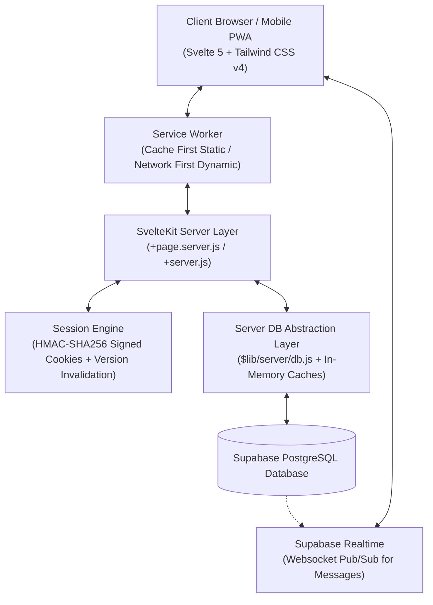
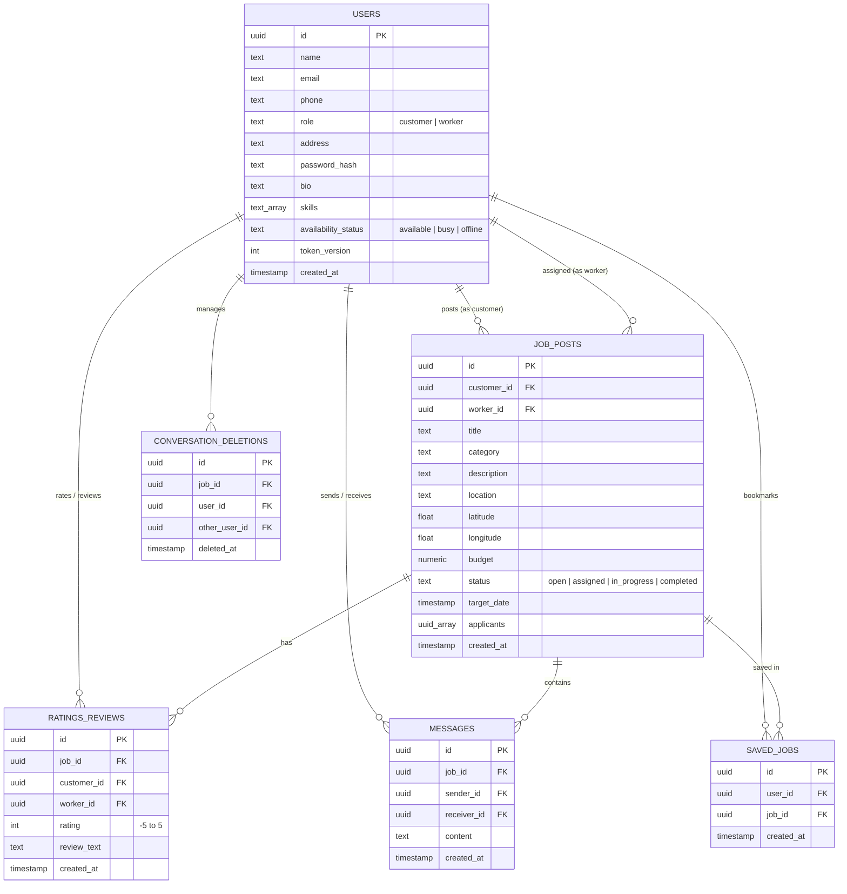

# 🛠️ Serviee — Hyperlocal On-Demand Service & Handyman Marketplace

<p align="center">
  
</p>

<p align="center">
  <strong>Connect local sideline workers, handymen, and skilled tradespeople with clients in their community!.</strong>
</p>

<p align="center">
  
  
  
  
  
  
</p>

---

## 📖 Table of Contents

- [Overview](#-overview)
- [Key Features](#-key-features)
  - [Customer (Service Seeker) Workflow](#1-customer-service-seeker-workflow)
  - [Worker (Service Provider) Workflow](#2-worker-service-provider-workflow)
  - [Real-Time Messaging & Chat](#3-real-time-messaging--chat)
  - [Interactive Map & Geolocation Engine](#4-interactive-map--geolocation-engine)
  - [Admin Back-Office & Moderation (`/admin05`)](#5-admin-back-office--moderation-admin05)
- [System Architecture & Tech Stack](#-system-architecture--tech-stack)
- [Security & Authentication Model](#-security--authentication-model)
- [Database Schema & Architecture](#-database-schema--architecture)
- [Project Directory Structure](#-project-directory-structure)
- [Environment Variables](#-environment-variables)
- [Getting Started & Installation](#-getting-started--installation)
  - [Prerequisites](#prerequisites)
  - [Setup Instructions](#setup-instructions)
  - [Running the App](#running-the-app)
- [Progressive Web App (PWA) Support](#-progressive-web-app-pwa-support)
- [Scripts & Development Commands](#-scripts--development-commands)
- [License](#-license)

---

## 🌟 Overview

**Serviee** is a modern, mobile-first, hyperlocal freelance and handyman marketplace web application. It connects local service seekers (clients needing repairs, carpentry, electrical work, plumbing, cleaning, moving, etc.) with qualified local workers and handymen in their immediate geographic area.

Built using **Svelte 5 (Runes)** and **SvelteKit 2**, with styling powered by **Tailwind CSS v4** and real-time backend persistence handled by **Supabase (PostgreSQL & Realtime)**, Serviee provides a lightning-fast, reactive, and offline-tolerant Progressive Web App (PWA) experience.

---

## ✨ Key Features

### 1. Customer (Service Seeker) Workflow
* **Job Posting Wizard (`/customer/post-job` & modal)**:
  * Categorized service selection (Plumbing, Electrical, Carpentry, Painting, Cleaning, Gardening, Appliance Repair, Moving & Hauling, General Labor).
  * Address autocomplete with Philippine administrative dataset & interactive GPS pinpoint coordinate picker (`LocationPickerModal.svelte`).
  * Budget estimation and target completion date scheduling.
* **Active Jobs Management (`CustomerActiveJobsTab.svelte`)**:
  * Status-driven filtering: `Open`, `Assigned`, `In Progress`, and `Completed`.
  * Applicant review: Inspect worker profiles, ratings, bio, skills, and past reviews.
  * One-click hiring/assignment and instant cancellation/deletion.
* **Review & Rating System (`CustomerRatingModal.svelte`)**:
  * Rate completed jobs with feedback scores (-5 to +5 / 1 to 5 stars) and detailed written testimonials.
* **Customer Profile & History (`CustomerProfileTab.svelte`)**:
  * View posted jobs metrics, completed service tally, and reviews submitted.

### 2. Worker (Service Provider) Workflow
* **Explore Job Feed (`WorkerFeedTab.svelte`)**:
  * Real-time list of available open job requests.
  * Search by keyword, filter by category, budget threshold, and distance radius.
* **Interactive Map Feed (`JobFeedMapView.svelte`)**:
  * Dual-mode toggle: Card list view vs. interactive OpenStreetMap view powered by Leaflet.
  * Dynamic GPS radius filtering (e.g., 5km, 10km, 25km, 50km from worker's current location).
  * Clustered markers and detailed job preview popups.
* **Job Application Lifecycle**:
  * One-click application submission with instant status feedback.
  * Ability to withdraw pending applications.
  * Status progression on hired jobs (`in_progress` &rarr; `completed`).
* **Saved Jobs / Bookmarks Drawer (`SavedJobsDrawer.svelte`)**:
  * Bookmark opportunities to track and apply later with persistent server-side storage.
* **Worker Profile & Availability (`WorkerProfileTab.svelte`)**:
  * Custom bio, hourly/project rate expectations, and dynamic skill badges.
  * Availability toggle status: `Available`, `Busy`, `Offline`.
  * Public worker profile modal (`ViewProfileModal.svelte`) with rating badges, badges breakdown, and reputation reviews.

### 3. Real-Time Messaging & Chat
* **Contextual Per-Job Chat (`CustomerChatTab.svelte` & `WorkerChatTab.svelte`)**:
  * Direct communication thread between client and worker scoped to each specific job.
  * Supabase Realtime channel subscription for zero-latency incoming message push (`realtimeChat.js`).
  * Image attachments preview modal (`ImagePreviewModal.svelte`).
  * Per-user conversation deletion support (`conversation_deletions` table) allowing users to clear chat history independently.

### 4. Interactive Map & Geolocation Engine
* **Leaflet & OpenStreetMap Integration (`MapViewer.svelte`, `JobFeedMapView.svelte`)**:
  * Map viewer with pinpoint markers for job locations.
  * Coordinate resolution via Philippine geographical centroids (`philippinesLocations.js`).
  * Haversine distance calculator (`gpsUtils.js`) for accurate geographic proximity calculations.

### 5. Admin Back-Office & Moderation (`/admin05`)
* **Passcode Lock Protection (`AdminPasscodeLock.svelte`)**:
  * Secured with configurable passcode and time-bound HMAC-signed admin session tokens (24-hour TTL).
* **System Overview & Analytics (`AdminOverviewTab.svelte`)**:
  * Aggregated metrics: Total users, client vs worker distribution, active vs completed jobs, chat volume, and review statistics.
* **User Management (`AdminUsersTab.svelte`)**:
  * Search, filter, inspect full user records, update addresses, trigger administrative password resets (`AdminResetPasswordModal.svelte`), or delete accounts.
* **Job Post Moderation (`AdminJobsTab.svelte`)**:
  * View all system jobs, inspect applicants, update job status, or remove inappropriate posts.
* **Review Moderation (`AdminReviewsTab.svelte`)**:
  * Monitor ratings, inspect review text, and delete abusive or fraudulent reviews.
* **System Diagnostics & Cache Control (`AdminSystemTab.svelte`)**:
  * Real-time database connectivity check, memory cache invalidation, and server status.

---

## 🏗️ System Architecture & Tech Stack



### Technology Matrix

| Layer | Technology | Details |
| :--- | :--- | :--- |
| **Frontend Framework** | [Svelte 5](https://svelte.dev/) | Uses modern Runes (`$state`, `$derived`, `$props`, `$effect`) |
| **Meta-Framework** | [SvelteKit 2](https://kit.svelte.dev/) | SSR, Form Actions, Server Loaders, and API Endpoints |
| **Styling** | [Tailwind CSS v4](https://tailwindcss.com/) | Modern CSS variables, glassmorphism, responsive utilities, dark/light themes |
| **Icons** | [Lucide Svelte](https://lucide.dev/) | Clean, consistent SVG icon set (`lucide-svelte` / `@lucide/svelte`) |
| **Maps & Geo** | [Leaflet.js](https://leafletjs.com/) | OpenStreetMap interactive map layers without API key dependencies |
| **Database** | [Supabase](https://supabase.com/) | Managed PostgreSQL instance with Realtime Replication |
| **Authentication** | Custom HMAC-SHA256 | Cryptographically signed session tokens with `token_version` invalidation |
| **PWA & Offline** | Web App Manifest & Service Worker | Install banner, offline caching, and instant reload |

---

## 🔒 Security & Authentication Model

1. **Signed Session Cookies**:
   * Sessions are created using `createSignedSession(userId, tokenVersion)` which produces `${userId}:${tokenVersion}.${signature}` using HMAC-SHA-256 with a private `SESSION_SECRET`.
   * Sessions are validated in `hooks.server.js` using `verifySignedSession()` with `crypto.timingSafeEqual` to prevent timing attacks.
2. **Instant Token Version Invalidation**:
   * Each user record has a `token_version` column.
   * Whenever a user resets their password or terminates active sessions, `token_version` is incremented, instantly revoking all existing session tokens.
3. **Dual-Role Account Isolation under Single Email**:
   * Users can register both a **Customer** and a **Worker** account using the same email address.
   * The system strictly enforces separate passwords between the two roles (`CONSTRAINT users_email_role_key UNIQUE (email, role)`).
4. **Admin Protection**:
   * The `/admin05` portal is gated by `ADMIN_PASSCODE` with a signed admin session token (`admin_${timestamp}.${signature}`) adhering to a strict 24-hour expiration window.

---

## 🗄️ Database Schema & Architecture

The database is built on PostgreSQL (via Supabase) with the following relational schema:



---

## 📁 Project Directory Structure

```text
serviee/
├── .env                         # Local environment configuration variables
├── package.json                 # Project dependencies and npm scripts
├── svelte.config.js             # SvelteKit adapter and compiler settings
├── vite.config.js               # Vite bundler configuration with Tailwind plugin
├── supabase_schema.sql          # Complete PostgreSQL schema, indexes, and policies
├── static/                      # Static assets, PWA icons, manifest
│   ├── ServieeLogo.png          # App brand logo
│   ├── manifest.json            # Web App Manifest for PWA installation
│   └── icons/                   # Multi-resolution PWA icons
└── src/
    ├── app.html                 # HTML shell, theme detection, meta headers
    ├── index.css                # Global styles, Tailwind directives, theme variables
    ├── hooks.server.js          # Session validation, cookie parsing, security checks
    ├── service-worker.js        # Offline caching & service worker lifecycle
    ├── lib/
    │   ├── assets/              # Component-level static media
    │   ├── CityAutocomplete.svelte  # Philippine municipality & city search input
    │   ├── FeedViewToggle.svelte    # List view / Map view switcher
    │   ├── JobFeedMapView.svelte    # Leaflet OpenStreetMap interactive job feed
    │   ├── LocationPickerModal.svelte # Interactive map coordinate picker
    │   ├── MapViewer.svelte         # Job location preview map
    │   ├── PasswordStrengthMeter.svelte # Live password complexity indicator
    │   ├── PwaInstallBanner.svelte  # Native PWA install prompt banner
    │   ├── SavedJobsDrawer.svelte   # Worker bookmarks drawer
    │   ├── ShareJobModal.svelte     # Social share & clipboard job link modal
    │   ├── ThemeToggle.svelte       # Light / Dark theme toggle button
    │   ├── ToastContainer.svelte    # Global reactive toast notifications container
    │   ├── ViewProfileModal.svelte  # Comprehensive user & worker profile viewer
    │   ├── gpsUtils.js              # Haversine distance math & GPS utilities
    │   ├── philippinesLocations.js  # Curated Philippine locations & centroids
    │   ├── realtimeChat.js          # Supabase Realtime channel subscription helper
    │   ├── savedJobs.svelte.js      # Svelte 5 reactive saved jobs store
    │   ├── toast.svelte.js          # Svelte 5 reactive toast notification store
    │   ├── validation.js            # Input validation routines (email, phone, pass)
    │   ├── admin/                   # Admin portal components (Overview, Users, Jobs, etc.)
    │   ├── customer/                # Customer dashboard tabs & modals
    │   ├── worker/                  # Worker dashboard tabs & modals
    │   └── server/
    │       ├── db.js                # Database abstraction layer & in-memory caches
    │       └── session.js           # HMAC session signing and verification logic
    └── routes/
        ├── +layout.svelte           # Global root layout, navbar, modals, toasts
        ├── +page.svelte             # Landing page with hero, statistics & categories
        ├── login/                   # User login with role selector
        ├── register/                # User registration with validation & GPS
        ├── logout/                  # Session termination endpoint
        ├── customer/                # Customer dashboard (Feed, Active Jobs, Chat, Profile)
        ├── worker/                  # Worker dashboard (Feed, Map View, Jobs, Chat, Profile)
        ├── settings/                # User account settings, profile & password management
        ├── admin05/                 # Protected admin management dashboard
        └── api/                     # REST API endpoints (jobs, messages, conversations, user)
```

---

## ⚙️ Environment Variables

Create a `.env` file in the root directory with the following variables:

```env
# Supabase Configuration
PUBLIC_SUPABASE_URL="https://your-project-id.supabase.co"
PUBLIC_SUPABASE_ANON_KEY="your-anon-public-key"

# Optional: Supabase Service Role Key (for admin operations)
SUPABASE_SERVICE_ROLE_KEY="your-service-role-key"

# Cryptographic Session Key (Change this in production)
SESSION_SECRET="your-super-secret-hmac-signing-key"

# Admin Dashboard Passcode (Used to access /admin05)
ADMIN_PASSCODE="1473"
```

---

## 🚀 Getting Started & Installation

### Prerequisites
* **Node.js**: `v18.x` or higher
* **npm** or **pnpm** or **yarn**
* **Supabase Account**: A free Supabase PostgreSQL project

### Setup Instructions

1. **Clone the repository**:
   ```bash
   git clone https://github.com/your-username/serviee.git
   cd serviee
   ```

2. **Install dependencies**:
   ```bash
   npm install
   ```

3. **Configure Environment Variables**:
   Copy or create your `.env` file with your Supabase credentials as shown in [Environment Variables](#-environment-variables).

4. **Initialize Database Schema**:
   * Open your **Supabase Dashboard** &rarr; **SQL Editor**.
   * Copy the entire contents of [`supabase_schema.sql`](supabase_schema.sql).
   * Run the SQL script to create all tables, indexes, and enable Realtime replication.

### Running the App

* **Start the development server**:
  ```bash
  npm run dev
  ```
  Open your browser and navigate to `http://localhost:5173`.

* **Start with auto-open browser**:
  ```bash
  npm run dev -- --open
  ```

---

## 📱 Progressive Web App (PWA) Support

Serviee is fully configured as an installable Progressive Web App:
* **Service Worker (`src/service-worker.js`)**: Implements cache-first strategy for static assets and network-first strategy with offline fallbacks for page navigation.
* **Manifest (`static/manifest.json`)**: Configured with responsive icons, theme colors, standalone display mode, and orientation settings.
* **Install Banner (`PwaInstallBanner.svelte`)**: Captures `beforeinstallprompt` to offer a seamless, one-tap installation prompt on Android, iOS, and Chromium desktop browsers.

---

## 🛠️ Scripts & Development Commands

| Command | Description |
| :--- | :--- |
| `npm run dev` | Starts the Vite development server with Hot Module Replacement (HMR) |
| `npm run build` | Builds the optimized production application |
| `npm run preview` | Locally previews the production build |
| `npm run check` | Runs SvelteKit sync and type-checks via `svelte-check` |
| `npm run check:watch`| Runs continuous type-checking in watch mode |

---

## 📄 License

This project is licensed under the [MIT License](LICENSE).
